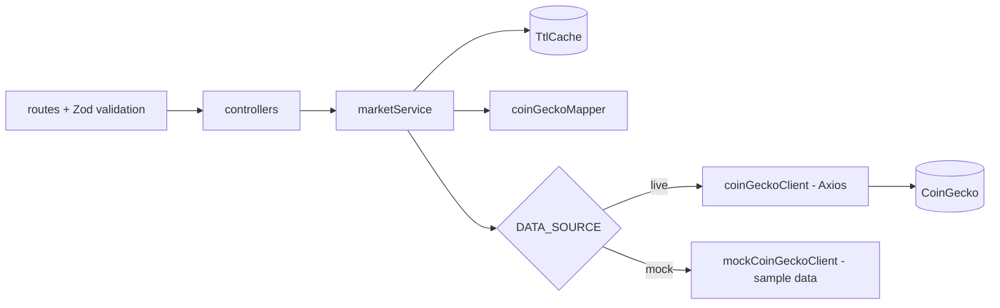

# Crypto Market Backend

[](https://github.com/ragavendars21/crypto_market_backend/actions/workflows/ci.yml)

Express API for the [Crypto Market Flutter app](https://github.com/ragavendars21/crypto_market_frontend).
It sits between the app and [CoinGecko](https://www.coingecko.com/en/api) and:

- **keeps the API key on the server**, so it never ships inside the mobile app;
- **validates every request** with Zod and rejects unknown or invalid parameters;
- **normalizes provider JSON** into a small, stable contract (missing values are `null`, never `0`);
- **caches responses** in memory, shares in-flight requests and serves stale data if the provider fails,
  which keeps us within the free plan's rate limit;
- **adds features the provider lacks**, such as sorting by price or 24h change.

Data provided by CoinGecko.

## Quick start

Requires Node.js 22.12 or newer.

```bash
npm install
cp .env.example .env     # Windows PowerShell: Copy-Item .env.example .env
npm run dev              # http://localhost:3000, restarts on file changes
```

By default `DATA_SOURCE=mock`, which serves built-in sample data and needs no API key.
For real data, get a free Demo key at <https://www.coingecko.com/en/api>, then set it in `.env`:

```env
DATA_SOURCE=live
COINGECKO_API_KEY=your-demo-key
```

The server refuses to start if the configuration is invalid (for example, live mode without a key).

> Start the server with `npm run dev` or `npm start`. Running `node src/server.js` directly skips
> `--env-file`, so `.env` is not loaded and the server silently uses the default mock mode.
> `GET /api/v1/health` reports which `dataSource` is active.

| Script | Purpose |
|---|---|
| `npm run dev` | Start with auto-restart |
| `npm start` | Start normally |
| `npm test` | Run the test suite (Vitest + Supertest, no network needed) |
| `npm run lint` | ESLint |

## Endpoints

Interactive docs: <http://localhost:3000/api-docs> (spec: [`docs/openapi.yaml`](docs/openapi.yaml)).

| Method | Path | Description |
|---|---|---|
| GET | `/api/v1/health` | Server status (never calls the provider) |
| GET | `/api/v1/coins` | Listing with `page`, `perPage`, `search`, `sort`, `movement`, `tier`; or `ids=a,b` for the watchlist |
| GET | `/api/v1/coins/:coinId` | Coin details |
| GET | `/api/v1/coins/:coinId/market-chart?range=1d\|7d\|30d\|1y` | Price history |
| GET | `/api/v1/market/global` | Global market statistics |

Examples:

```bash
curl "http://localhost:3000/api/v1/coins?sort=price_desc&tier=large&perPage=5"
curl "http://localhost:3000/api/v1/coins?ids=bitcoin,ethereum"
curl "http://localhost:3000/api/v1/coins/bitcoin/market-chart?range=7d"
```

Success: `{ "data": ..., "meta": { "source": "live|mock|stale", "cachedAt": "..." } }`
Error: `{ "error": { "code": "COIN_NOT_FOUND", "message": "..." } }`

| Status | Code | Meaning |
|---|---|---|
| 400 | `VALIDATION_ERROR` | Invalid parameter (see `details`) |
| 404 | `COIN_NOT_FOUND` / `ROUTE_NOT_FOUND` | Unknown coin or endpoint |
| 429 | `RATE_LIMITED` | This server's per-IP limit (`Retry-After` header) |
| 502 | `UPSTREAM_ERROR` | Provider error or malformed provider response |
| 503 | `UPSTREAM_RATE_LIMITED` | Provider rate limit and nothing cached (`Retry-After` header) |
| 504 | `UPSTREAM_TIMEOUT` | Provider too slow |

## How it works



```text
src/
├── server.js              Opens the port; graceful shutdown
├── app.js                 Builds the Express app (used directly by tests)
├── dependencies.js        Chooses live or mock client and wires the service
├── config/env.js          Zod-validated environment variables
├── config/marketData.js   Chart ranges, cache TTLs, universe size
├── routes/                Paths + validation middleware
├── controllers/           HTTP in → service → JSON envelope out
├── services/              marketService (caching, use cases), marketQuery (pure search/filter/sort)
├── clients/               CoinGecko client (timeouts, retry policy, error mapping) and mock client
├── mappers/               Provider JSON → API contract, null-safe
├── schemas/               Zod request schemas
├── middleware/            validate, error handler
├── fixtures/              Sample data in CoinGecko's raw format
└── utils/                 TtlCache, AppError, error factories, response helper
```

**Why fetch the top 250 and sort here?** CoinGecko's `/coins/markets` can only sort by market cap,
volume or ID. Sorting one small page at a time by price would be misleading. One cached request for
the top 250 coins per minute serves every search, filter and sort combination. The trade-off is that
search covers those 250 coins; watchlist lookups by `ids` work for any coin.

**Caching:** markets and coin details 60 s, global stats 120 s, charts 2 min (1d) to 1 h (1y).
Concurrent requests for the same key share one provider call. If a refresh fails, the expired copy
is returned with `meta.source: "stale"` (never for "coin not found").

**Retries:** one retry after a network error or 502/503/504. No retry on 429 (it would worsen the
rate limit) or on timeouts (the request already waited the full timeout).

**Mock mode** swaps only the client, so mappers, query logic and caching run exactly as in live mode.
